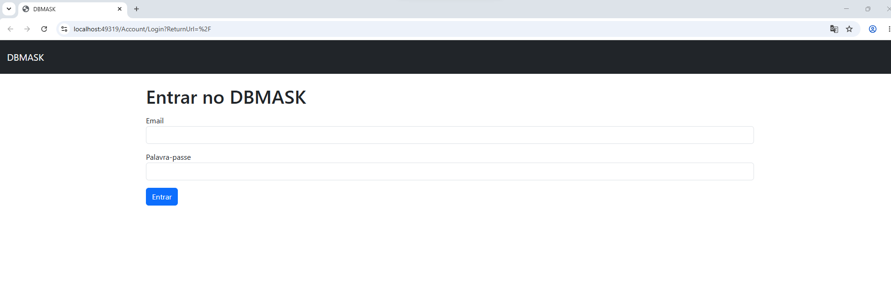
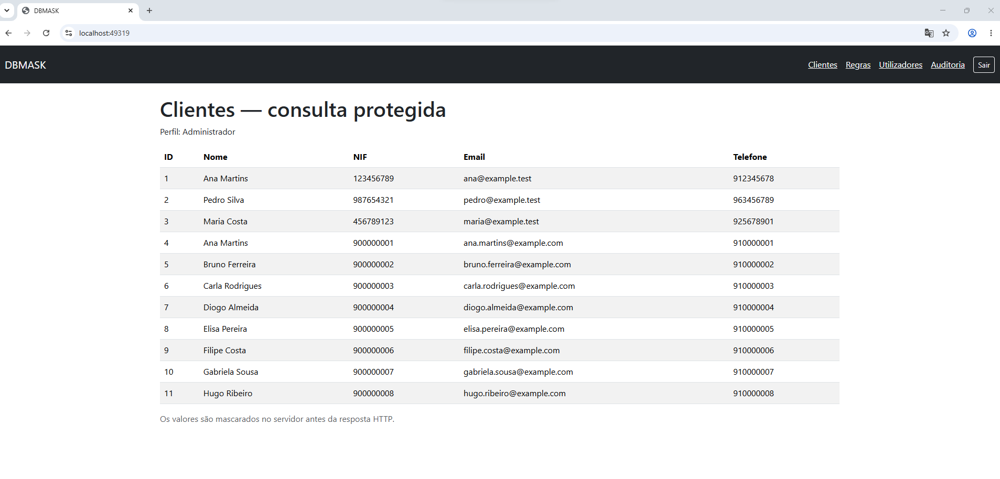
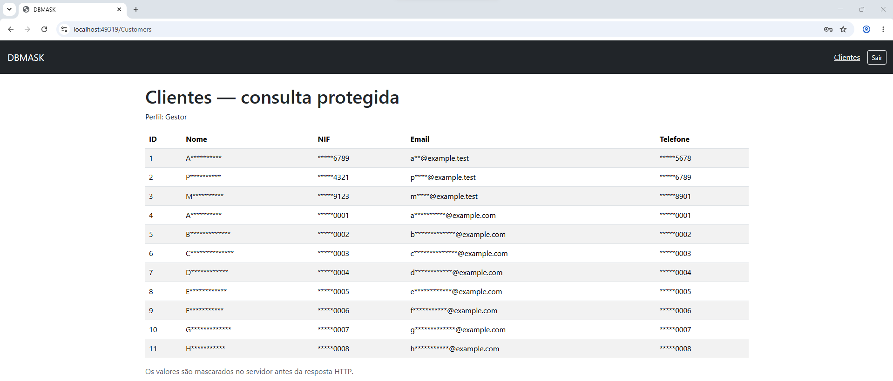
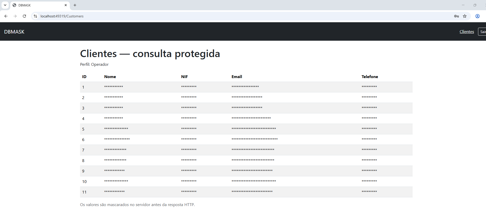
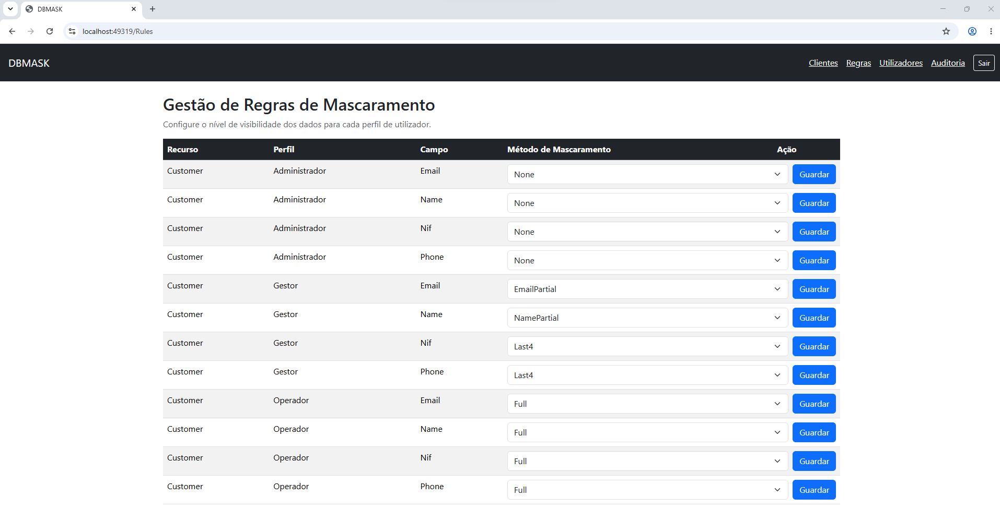
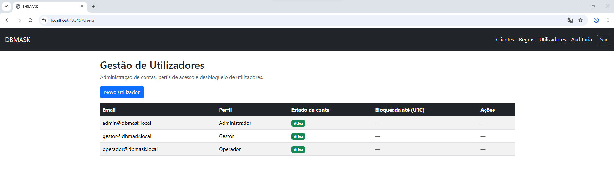
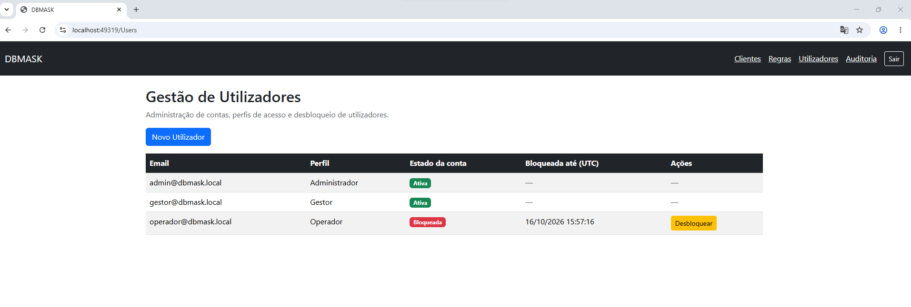
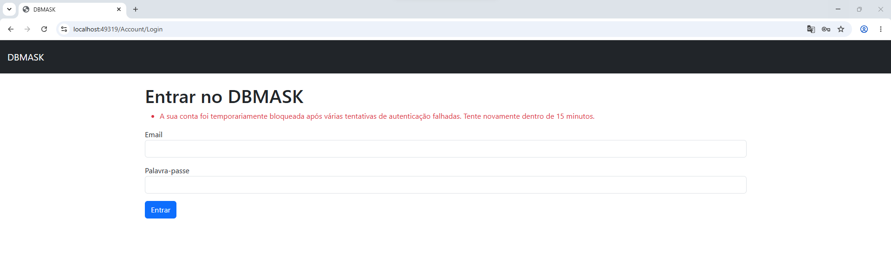
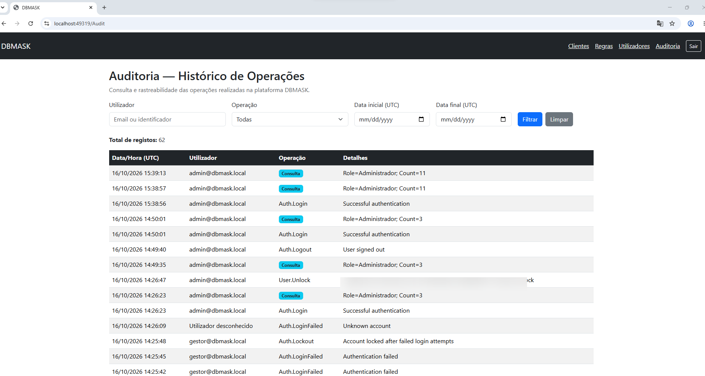

# DBMASK — Plataforma de Mascaramento de Dados

**ASP.NET Core MVC | C# | SQL Server | Entity Framework Core | ASP.NET Core Identity**

**Autora:** Flórida Araújo

## 1. Sobre o projeto

O **DBMASK** é uma aplicação web desenvolvida em ASP.NET Core MVC que demonstra a implementação de mecanismos de mascaramento de dados sensíveis, de acordo com os perfis de acesso dos utilizadores.

O projeto foi desenvolvido como uma prova de conceito (*Proof of Concept — PoC*), com o objetivo de explorar e partilhar conhecimentos nas áreas de:

- Desenvolvimento de aplicações .NET.
- Segurança e proteção de dados.
- Mascaramento dinâmico de informação.
- Controlo de acessos baseado em perfis (*Role-Based Access Control — RBAC*).
- Autenticação e gestão de utilizadores.
- Auditoria e rastreabilidade de operações.
- Integração com bases de dados SQL Server.

**O mascaramento é aplicado no servidor, antes da resposta HTTP**, impedindo que os valores originais dos campos protegidos sejam enviados ao navegador quando o perfil não está autorizado a consultá-los.

---

## 2. Tecnologias utilizadas

| Tecnologia | Finalidade |
|---|---|
| C# | Linguagem de programação |
| ASP.NET Core MVC | Desenvolvimento da aplicação web |
| Entity Framework Core | Persistência e Migrations |
| Microsoft SQL Server | Base de dados relacional |
| ASP.NET Core Identity | Autenticação e gestão de utilizadores |
| Razor Views | Interfaces da aplicação |
| LINQ | Consultas e tratamento de dados |
| HTML, CSS e Bootstrap | Apresentação |
| Git e GitHub | Controlo de versões e partilha |

---

## 3. Funcionalidades

### 3.1. Autenticação e autorização

A aplicação utiliza ASP.NET Core Identity para autenticação e autorização.

Estão definidos três perfis:

| Perfil | Permissões |
|---|---|
| **Administrador** | Consulta de clientes, gestão de regras, utilizadores e auditoria |
| **Gestor** | Consulta de clientes com mascaramento parcial |
| **Operador** | Consulta de clientes com mascaramento completo |

As permissões administrativas são protegidas através de autorização baseada em perfis.

### 3.2. Motor de mascaramento

O serviço `MaskEngine` implementa diferentes estratégias de proteção:

| Estratégia | Descrição |
|---|---|
| `None` | Apresentação integral do valor |
| `Full` | Mascaramento completo |
| `Last4` | Apresentação dos últimos quatro caracteres |
| `EmailPartial` | Mascaramento parcial do email |
| `NamePartial` | Mascaramento parcial do nome |

As estratégias são configuráveis por campo e perfil.

O serviço `CustomerReader` aplica as regras antes de disponibilizar os dados à interface.

### 3.3. Gestão de regras

O Administrador pode configurar o método de mascaramento aplicável a cada campo e perfil.

As regras são armazenadas na base de dados, permitindo alterar o comportamento da aplicação sem modificar diretamente o código do motor de mascaramento.

### 3.4. Gestão de utilizadores

A aplicação permite:

- Criar contas de utilizador.
- Atribuir perfis de acesso.
- Consultar o estado das contas.
- Identificar contas temporariamente bloqueadas.
- Desbloquear manualmente utilizadores.

### 3.5. Segurança da autenticação

Foram implementados mecanismos de segurança, incluindo:

- Comprimento mínimo de 12 caracteres para palavras-passe.
- Bloqueio após cinco tentativas de autenticação falhadas.
- Período de bloqueio de 15 minutos.
- Desbloqueio manual pelo Administrador.
- Cookies de autenticação com `HttpOnly`, `Secure` e `SameSite=Lax`.

### 3.6. Auditoria e rastreabilidade

O DBMASK regista operações relevantes, incluindo:

- Autenticações bem-sucedidas.
- Tentativas de autenticação falhadas.
- Bloqueios de contas.
- Desbloqueios administrativos.
- Consultas de dados de clientes.
- Terminação de sessões.

A interface de auditoria permite filtrar registos por utilizador, operação e intervalo de datas, com paginação dos resultados.

---

## 4. Arquitetura

O projeto segue o padrão **Model-View-Controller (MVC)**, com separação entre apresentação, lógica aplicacional e acesso a dados.

### Principais componentes

| Componente | Responsabilidade |
|---|---|
| `Controllers` | Processamento de pedidos e autorização |
| `Models` | Entidades e modelos da aplicação |
| `Views` | Interfaces Razor |
| `Services/MaskEngine` | Estratégias de mascaramento |
| `Services/CustomerReader` | Consulta protegida dos dados |
| `Data/AppDbContext` | Persistência através de EF Core |
| `Data/Bootstrap` | Inicialização da base de dados, perfis e regras |
| `Migrations` | Evolução do esquema da base de dados |

### Estrutura do projeto

```text
DBMASK.Web/
├── Controllers/
├── Data/
├── Migrations/
├── Models/
├── Services/
├── Views/
├── database/
│   └── seed_customers.sql
├── docs/
│   └── screenshots/
│       ├── 01-login.png
│       ├── 02-clientes-administrador.png
│       ├── 03-clientes-gestor.png
│       ├── 04-clientes-operador.png
│       ├── 05-regras.png
│       ├── 06-utilizadores.png
│       ├── 07-conta-bloqueada.png
│       ├── 08-login-bloqueado.png
│       └── 09-auditoria.png
├── Program.cs
├── appsettings.json
├── .gitignore
├── README.md
└── DBMASK.Web.csproj
```

---

## 5. Base de dados

A aplicação utiliza Microsoft SQL Server e Entity Framework Core.

As principais tabelas são:

| Tabela | Finalidade |
|---|---|
| `Customers` | Dados dos clientes |
| `MaskRules` | Regras de mascaramento |
| `AuditEntries` | Registos de auditoria |
| Tabelas ASP.NET Core Identity | Utilizadores, perfis e autenticação |

### 5.1. EF Core Migrations

As Migrations encontram-se incluídas no projeto e permitem recriar a estrutura da base de dados.

Durante a inicialização, o método `Bootstrap.InitializeAsync()` aplica as Migrations pendentes e inicializa os perfis e as regras de mascaramento necessários.

Não é necessário restaurar um backup SQL Server (`.bak`).

### 5.2. Configuração local

A ligação à base de dados e as credenciais iniciais do Administrador podem ser configuradas através de **ASP.NET Core User Secrets**.

Exemplo:

```json
{
  "ConnectionStrings": {
    "DBMASK": "Server=localhost;Database=DBMASK_Platform;Trusted_Connection=True;TrustServerCertificate=True"
  },
  "Bootstrap": {
    "AdminEmail": "admin@dbmask.local",
    "AdminPassword": "DEFINIR_LOCALMENTE"
  }
}
```

O valor `DEFINIR_LOCALMENTE` deve ser substituído por uma palavra-passe forte.

**As credenciais reais e os ficheiros de segredos não devem ser publicados no GitHub.**

### 5.3. Dados fictícios

O projeto disponibiliza um script SQL para inserir clientes fictícios:

`database/seed_customers.sql`

O script deve ser executado no SQL Server Management Studio após a criação da base de dados através das Migrations.

Os dados permitem testar as diferentes estratégias de mascaramento.

---

## 6. Como executar o projeto

### Pré-requisitos

- Visual Studio com suporte para ASP.NET Core.
- SDK .NET compatível com o projeto.
- Microsoft SQL Server.
- SQL Server Management Studio (recomendado).
- Git.

### Passo 1 — Clonar o repositório

```bash
git clone https://github.com/FgAraujo-web/DBMASK.git
```

### Passo 2 — Abrir o projeto

Abrir a solução no Visual Studio e restaurar os pacotes NuGet.

### Passo 3 — Configurar os User Secrets

No Visual Studio:

1. Clicar com o botão direito do rato no projeto `DBMASK.Web`.
2. Selecionar **Manage User Secrets**.
3. Configurar a ligação ao SQL Server e as credenciais iniciais do Administrador.
4. Guardar as alterações.

### Passo 4 — Inicializar a base de dados

Executar a aplicação.

O Bootstrap aplica as Migrations pendentes e cria os perfis e regras iniciais.

### Passo 5 — Inserir dados fictícios

Executar no SQL Server Management Studio o ficheiro:

`database/seed_customers.sql`

### Passo 6 — Testar os perfis

Autenticar-se como Administrador e criar contas com os perfis Gestor e Operador através da interface de gestão de utilizadores.

Iniciar sessão com cada perfil para comparar os diferentes níveis de mascaramento.

---

## 7. Contas de demonstração

O DBMASK permite testar três níveis de acesso através de contas de demonstração.

| Perfil | Email de exemplo | Criação |
|---|---|---|
| **Administrador** | `admin@dbmask.local` | Automática, durante a inicialização |
| **Gestor** | `gestor@dbmask.local` | Através da gestão de utilizadores |
| **Operador** | `operador@dbmask.local` | Através da gestão de utilizadores |

A conta Administrador é criada automaticamente utilizando as credenciais configuradas através de User Secrets.

As contas Gestor e Operador devem ser criadas pelo Administrador, com os respetivos perfis e palavras-passe.

Os emails apresentados são fictícios e destinam-se exclusivamente à demonstração.

As palavras-passe não são disponibilizadas no repositório.

---

## 8. Demonstração das interfaces

As capturas seguintes apresentam as principais funcionalidades do DBMASK.

### 8.1. Autenticação

Acesso à aplicação através de ASP.NET Core Identity.



### 8.2. Consulta protegida de clientes

O DBMASK permite apresentar os mesmos registos com diferentes níveis de visibilidade, de acordo com o perfil autenticado.

#### Administrador — Visualização integral

O Administrador consulta os campos sem mascaramento, de acordo com as regras configuradas.



#### Gestor — Mascaramento parcial

O Gestor consulta os dados com mascaramento parcial dos campos sensíveis.

São utilizadas estratégias como `NamePartial`, `EmailPartial` e `Last4`.



#### Operador — Mascaramento completo

O Operador consulta os registos com os campos sensíveis integralmente mascarados através da estratégia `Full`.



**O mascaramento é realizado no servidor, antes da resposta HTTP.**

### 8.3. Gestão de regras de mascaramento

O Administrador pode configurar o método de mascaramento aplicável a cada campo e perfil.



### 8.4. Gestão de utilizadores

A interface permite consultar contas, identificar perfis e verificar o estado dos utilizadores.



### 8.5. Bloqueio e desbloqueio de contas

Após cinco tentativas de autenticação falhadas, a conta é temporariamente bloqueada durante 15 minutos.

O Administrador pode identificar contas bloqueadas e proceder ao desbloqueio manual.



A aplicação apresenta uma mensagem informativa quando a conta se encontra temporariamente bloqueada.



### 8.6. Auditoria e rastreabilidade

O DBMASK mantém um histórico das operações realizadas, incluindo autenticações, tentativas falhadas, bloqueios, desbloqueios e consultas de dados.

A interface permite filtrar os registos por utilizador, operação e intervalo de datas.



---

## 9. Segurança e âmbito

O DBMASK é uma **prova de conceito técnica**, desenvolvida para fins de aprendizagem e partilha de conhecimento.

A aplicação demonstra mecanismos de:

- Mascaramento de dados no servidor.
- Controlo de acessos baseado em perfis.
- Gestão de identidades.
- Proteção da autenticação.
- Auditoria e rastreabilidade.
- Persistência de regras de mascaramento.
- Gestão da estrutura da base de dados através de Migrations.

O projeto não deve ser considerado, por si só, uma solução certificada ou pronta para utilização em produção.

A adoção em ambientes reais exige avaliações adicionais de segurança, privacidade, testes e requisitos operacionais.

---

## 10. Objetivo da partilha

Este repositório é disponibilizado para **partilhar conhecimento técnico e demonstrar a implementação prática de mecanismos de mascaramento de dados em aplicações .NET**.

O projeto integra conceitos de desenvolvimento aplicacional, bases de dados, segurança da informação, autenticação, autorização e auditoria.

---

## 11. Autoria

**Flórida Araújo**

*Sistemas de Informação | Desenvolvimento de Aplicações | Bases de Dados | Análise Funcional e Técnica*

[LinkedIn](https://www.linkedin.com/in/fgaraujo) | [GitHub](https://github.com/FgAraujo-web)

---

**DBMASK — Demonstração de mascaramento de dados e controlo de acessos em ASP.NET Core MVC.**